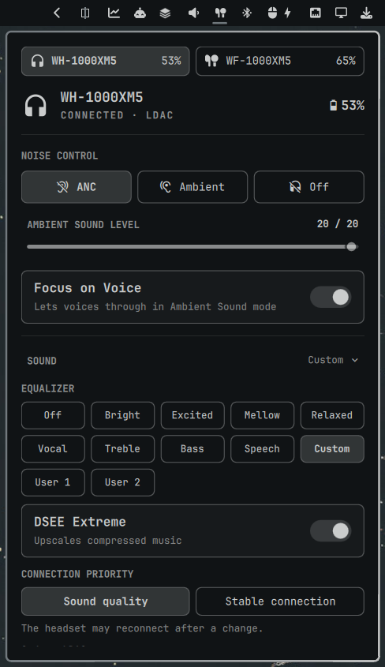
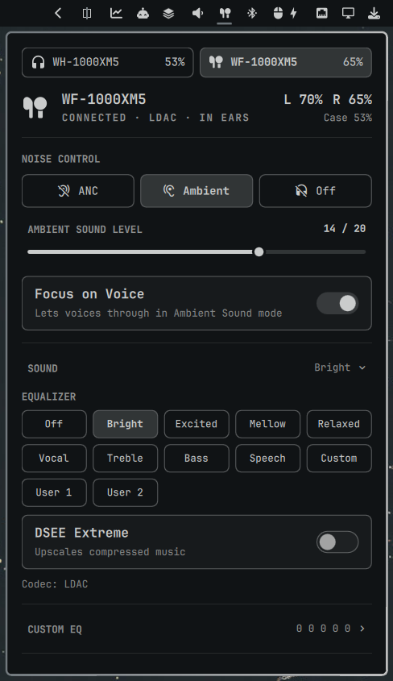

# Sony XM5 for Omarchy

English | [Русский](README.ru.md)

Control Sony WH-1000XM5 headphones and WF-1000XM5 earbuds from the
[Omarchy](https://omarchy.org) bar: battery, noise cancelling, equalizer and
the other settings the Sony phone app has. No phone needed.

| WH-1000XM5 | WF-1000XM5 |
|---|---|
|  |  |

## Install

You need Omarchy and the headset paired and connected over Bluetooth.

```bash
omarchy plugin add https://github.com/enxy0/omarchy-sony-xm5 --enable
```

Then click the headphones icon in the bar and press **Install**. It builds and
starts a small background service for your user. It needs BlueZ and D-Bus,
which Omarchy has, and installs the missing build packages (`cmake`, `ninja`,
`gcc`, `bluez-libs`) with pacman; only then does sudo ask for a password.

To update, run `omarchy plugin update io.github.enxy0.sonyxm5`; the panel
offers **Update** if the service needs it too.

To remove:

```bash
~/.config/omarchy/plugins/io.github.enxy0.sonyxm5/setup --uninstall
omarchy plugin remove io.github.enxy0.sonyxm5
```

More on setup, removal and the Arch package: [docs/install.md](docs/install.md).

## Use

- **Left click** the icon to open the panel, **right click** to switch noise
  cancelling, ambient sound and off.
- With both models connected, the panel has a tab for each, and the icon
  shows the one playing from this computer.
- The panel works from the keyboard: `j` `k` move, `h` `l` change, `Enter`
  selects, `[` `]` switch headsets, `Esc` closes.


The same controls work from a terminal:

```bash
sony-ctl noise anc
sony-ctl -H wf-1000xm5 ambient-level 12
sony-ctl eq bright
```

All commands: [docs/cli.md](docs/cli.md).

## Features

Noise cancelling and ambient sound with Focus on Voice, equalizer presets and
a custom 5-band equalizer with Clear Bass, DSEE Extreme, Speak-to-Chat, volume,
voice guidance, auto power off, pause when taken off, multipoint with switching
the audio source, codec and battery (left, right and case for the earbuds).
WH-1000XM5 only: connection priority, NC/AMB button, touch panel, Quick Access.
WF-1000XM5 only: touch function per earbud, hearing your own voice in calls.

Every setting was tested on a WH-1000XM5 (firmware 2.5.1) and a WF-1000XM5
(firmware 6.1.0). The panel shows only what the connected headset supports.

## More

- [docs/install.md](docs/install.md): what setup does, removal, the Arch
  package, choosing headsets.
- [docs/cli.md](docs/cli.md): `sony-ctl` commands.
- [docs/troubleshooting.md](docs/troubleshooting.md): when something does not
  work, and what to attach to an issue.
- [docs/development.md](docs/development.md): building, tests, the mock
  daemon.
- [docs/protocol.md](docs/protocol.md): the Sony protocol as this project
  uses it, with the hardware test results.

Unofficial project, not affiliated with Sony. Started as a fork of
[andROYdified/omarchy-sony](https://github.com/andROYdified/omarchy-sony);
protocol knowledge from
[mos9527/SonyHeadphonesClient](https://github.com/mos9527/SonyHeadphonesClient)
and [Gadgetbridge](https://codeberg.org/Freeyourgadget/Gadgetbridge)
([notices](THIRD_PARTY_NOTICES.md)). MIT license.
